<p align="center">
  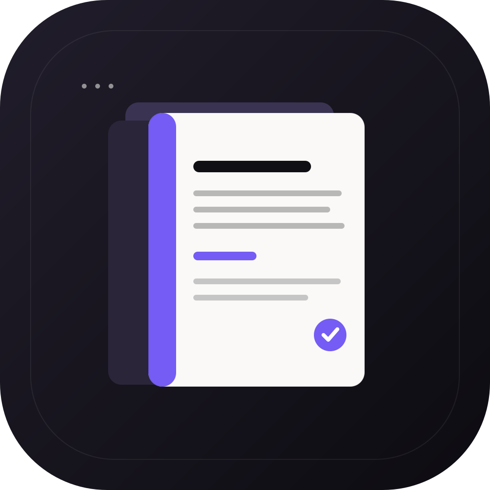
</p>

<h1 align="center">Folio</h1>

<p align="center">
  <strong>A local-first notebook for Linux, Windows and macOS.</strong><br>
  Notebooks, sections and pages; freeform pages with note containers, outlines, tags, tables, equations, ink and file printouts; English and French. Native Rust and <a href="https://github.com/emilk/egui">egui</a>: no Electron, no webview, no account.
</p>

<p align="center">
  <a href="#features">Features</a> ·
  <a href="#build-and-run">Build &amp; run</a> ·
  <a href="#keyboard">Keyboard</a> ·
  <a href="#where-your-notes-live">Your data</a> ·
  <a href="https://moshemalawach.github.io/folio/">Website</a> ·
  <a href="https://github.com/moshemalawach/folio">GitHub</a>
</p>

<p align="center">
  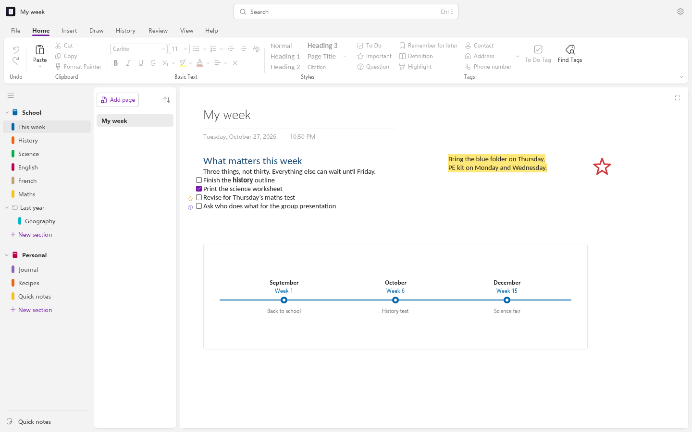
</p>

> **Status:** early alpha. Folio is an independent, local-first notebook that keeps everything on your computer. It contains no third-party notebook application code and uses only open-licensed fonts and icons, listed in [THIRD_PARTY.md](THIRD_PARTY.md). It is tested on Linux; the Windows and macOS builds come from the same code and are built by the CI matrix, but the author has not run them on real Windows or Mac hardware. Folio needs no account, sends no telemetry and makes no network connections.

## Features

The groups follow the familiar desktop-notebook ribbon, so each command stays where you expect it.

**Pages and notes**

- **Notebooks, section groups, sections and pages**, in a navigation pane and a page list. Sections take the 16 section colours, section groups nest, and pages have two levels of subpages. Pages and sections are dragged into place, or sent to another section or notebook with Move or Copy… (`Ctrl+Alt+M` for a page).
- **One page type: click anywhere and type.** A note container shows its frame and grab bar only on hover or while typing. It widens as you type, up to the edge of the page in view, and its ◂▸ handle sets the width. Shift+drag one note onto another to merge them. An emptied note goes away.
- **The title, date and time sit on the page.** Click the date or the time to change it. The page has no fixed width: it grows down and to the right as you write.
- **Outlines** nine levels deep: `Tab` and `Shift+Tab` (or `Alt+Shift+→` / `←`) change a paragraph's level. The paragraph handle in the margin selects a paragraph with its subparagraphs, folds them on a double-click ("+" unfolds) and drags them. `Alt+Shift+1`…`9` show levels and `Alt+Shift+↑` / `↓` move paragraphs.
- **Autosave** to one SQLite file, moments after each change; `Ctrl+S` saves at once.

**Home**

- **Clipboard:** Paste ▾ with Keep Source Formatting, Merge Formatting and Keep Text Only (offered again by the Paste Options button after a paste), Cut, Copy and the Format Painter (a double-click keeps it on until `Esc`). Formatting comes in from web pages and word processors; `Ctrl+Shift+V` pastes text only.
- **Basic Text:** six bundled faces, with Carlito (Calibri's metrics) at 11 pt as the default; sizes 8–72 pt; bullet and numbering libraries; indents; bold, italic, underline, strikethrough, subscript and superscript; six highlighter colours, seven font colours, alignment and Clear Formatting.
- **Styles:** Heading 1–6, Page Title, Citation, Quote, Code and Normal (`Ctrl+Alt+1`…`6` for the headings).
- **Tags:** 29 built-in tags, and your own made in Customize Tags…, in the paragraph's left margin; checkbox tags such as Call back tick with a click. `Ctrl+1`…`9` apply the gallery's first nine on the digit-row keys (AZERTY too) and `Ctrl+0` removes them.

**Insert**

- **Tables** from a 10 × 8 grid, with spreadsheet-style keys (`Tab`, `Enter`, `Ctrl+Enter`, `Alt+Enter`, `Ctrl+Alt+R` / `E`) and a Table tab: select, insert and delete rows and columns, hide borders, shading, alignment, sort and header row. Drag a column border to set its width.
- **File Printout** of a PDF: each page lands on the page as a picture, at its printed size, under the file's icon. Its text is searchable and copyable, a dropped or pasted PDF asks *Insert printout* or *Attach file*, and a password-protected PDF asks for its password. Pages are drawn in Rust by hayro, so there is no PDF software to install. **File Attachment** keeps any file up to 200 MB as a card that opens in its usual app.
- **Pictures** from a file, a drop or a paste, inside a note or floating on the page, with a Picture tab: rotate, flip, Alt Text, Set Picture as Background and Restore Original Size.
- **Link** (`Ctrl+K`) to web pages, e-mail addresses, files, pages and sections; typed web addresses link themselves, and `Ctrl+click` opens a link.
- **Record Audio** while you type; **Date**, **Time** and **Date & Time** stamps; **Page Templates** (Blank, Lecture notes, To-do list, Meeting notes); **Equation** (`Alt+=`), typed in a linear form or in LaTeX and drawn built up; **Symbol**, a grid of 48 symbols.
- **Insert Space**, and Folio's own **Frise**: a timeline of dated milestones.

**Draw**

- **Type, Lasso and Pan.** The lasso selects the ink and items inside a loop; `Space`+drag, or a middle or right drag, pans with any tool.
- **Pens:** an eraser (stroke, or three point sizes), six pens and highlighters with five thicknesses and 16 colours each, and Add Pen. Your pens are kept for the next start.
- **Shapes:** rectangle, rounded rectangle, ellipse, triangle, diamond, line and arrow, with Lock Drawing Mode, a Fill colour and a typed label. **Ink to Shape** tidies rough lines, rectangles, ellipses, triangles and diamonds as you draw.
- **Arrange and Rotate:** bring forward or send back, and quarter turns and flips for ink, shapes and pictures.

**History**

- **Page Versions:** Folio keeps a version when you change a page after leaving it alone for 10 minutes, up to 100 per page. The pane beside the page previews a version and restores it, and the page as it was is kept as a version too. Its menu deletes the versions of a page, a section or a notebook.
- **Recent Edits:** the pages changed today, since yesterday, in the last 7, 14 or 30 days, the last 3 or 6 months, or every page by date, in a pane beside the page.
- **Notebook Recycle Bin:** deleted pages, with their subpages, wait there until you restore them, delete them for good or empty the bin.

**Review**

- **Spelling as you type:** misspelled words get a red wavy underline, and the right-click menu offers suggestions, Add to dictionary and Ignore all. `F7` opens the Spelling pane, with Change, Ignore, Ignore All and Add to Dictionary.
- **Proofing Language:** English (US) and French dictionaries are built in, and other Hunspell dictionaries on the system are offered. Automatic checks the system's language and English together.

**View**

- **Normal View and Full Page View** (`F11`, or the ↗↙ button at the page's top right).
- **Tabs Layout:** Vertical Tabs, or Horizontal Tabs with pastel section tabs across the top, a tinted page list on the right (or the left), and a notebook picker that pins as a pane.
- **Page Color** (16 pale colours and More Colors…), **Rule Lines** (four ruled and four grid sizes, Rule Line Color, Always Create Pages with Rule Lines; `Ctrl+Shift+R`), **Hide Page Title** and **Switch Background**.
- **Zoom:** Zoom Out, Zoom In, 100% and Page Width; `Ctrl`+wheel zooms too.
- **Immersive Reader:** text size, Paper, White, Sepia and Dark themes, line focus of 1, 3 or 5 lines, and reading aloud with the system's voice.
- **Light, dark or system theme** (File › Options › General). The chevron at the ribbon's bottom right switches between the Classic and Simplified ribbons, and `Ctrl+F1` shows the tabs only.

**Search and tags**

- **Search** from the box at the top of the window (`Ctrl+E`): results drop down as you type, each with its page, its place and a snippet, and a page opens with the words highlighted. The scope menu offers Find on This Page, This Section, This Section Group, This Notebook or All Notebooks, and Set This Scope as Default keeps the choice. `Alt+O` opens the Search Results pane.
- Search finds text in titles, notes, tables, shape labels, frises and printout pages. It does not read handwriting, pictures or recordings.
- **Find on page** (`Ctrl+F`): `Enter` or `F3` steps through the matches, and `Esc` leaves the caret on the match.
- **Find Tags** opens the Tags Summary pane: every tagged line in the section, the notebook or all notebooks, grouped by tag name, section, page title, date or note text, and only the unchecked ones if you like. A click goes to the line, and Create Summary Page writes the list to a new page.

**Import notebooks**

- File › Open › Import notebook… copies a notebook package (`.onepkg`), a notebook folder or a single section (`.one`) into a new Folio notebook, from this computer or a synced folder. The source files are only read.
- Containers, outlines, formatting, tags, links, tables, pictures, attached files, equations in linear form and ink come along, and a report lists what was left out. See [Importing notebooks](#importing-notebooks).

**Export and print**

- **Print** (File › Print, or `Ctrl+P`) opens a print-ready copy of the page in your web browser, which prints it or saves it as a PDF.
- **Export** (File › Export, or Export… on a section's menu) saves a page as a web page, or a section or a notebook as a folder of pages with an index. Pictures, small attached files, recordings, tables, equations (as MathML) and printouts go with them.
- **Back up** (File › Info, or File › Options › Save & Backup) copies the library and its pictures and files to a place you pick.

**Languages**

- English and French interfaces, switched at once in File › Options › Language. Automatic follows the system language.
- Standard French terms, French dates, numbers and key names, and sample notebooks written in the language Folio first starts in. See [Languages](#languages).

## Pictures

<p align="center">
  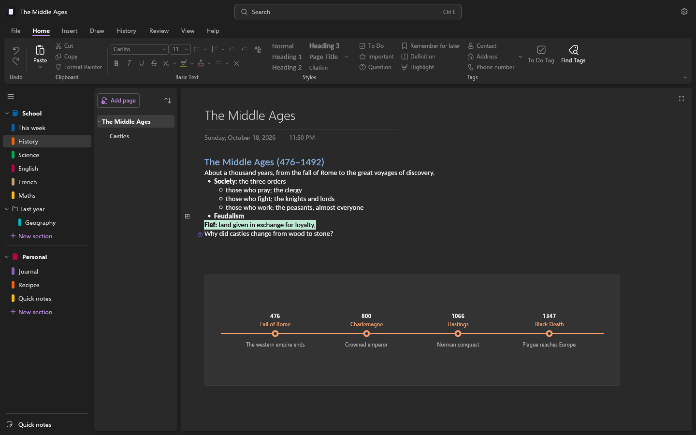
  <br><sub>The dark theme: an outline with a folded paragraph, tags in the margin and a frise.</sub>
</p>

<p align="center">
  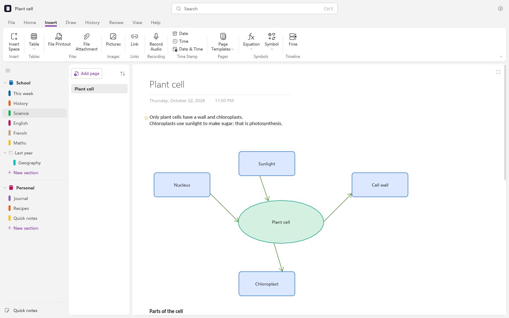
  <br><sub>The Insert tab, over a diagram drawn with shapes and arrows.</sub>
</p>

<p align="center">
  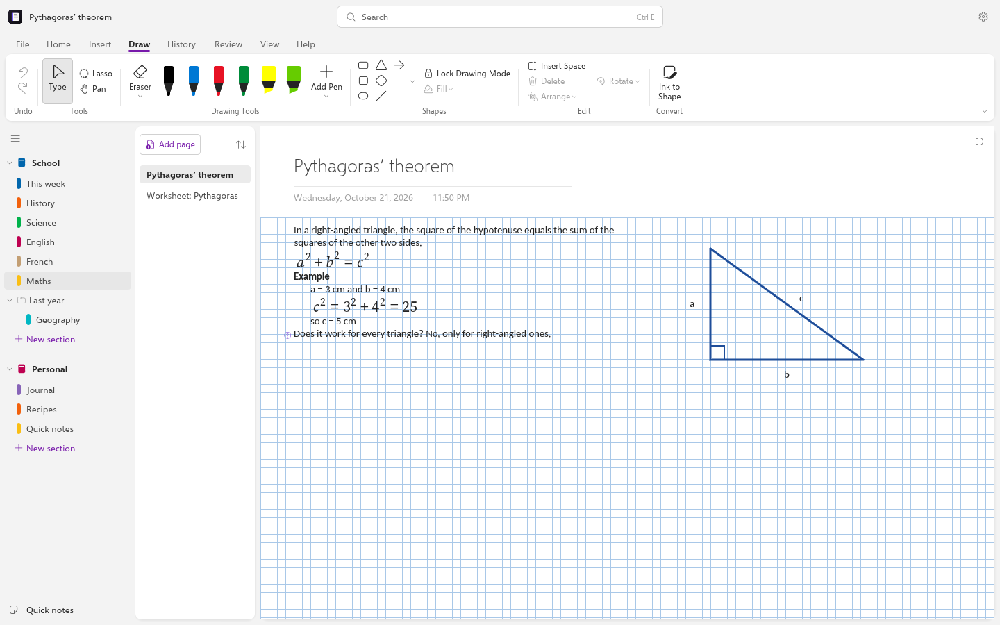
  <br><sub>The Draw tab: pens, erasers, shapes and Ink to Shape, with equations and ink on grid paper.</sub>
</p>

<p align="center">
  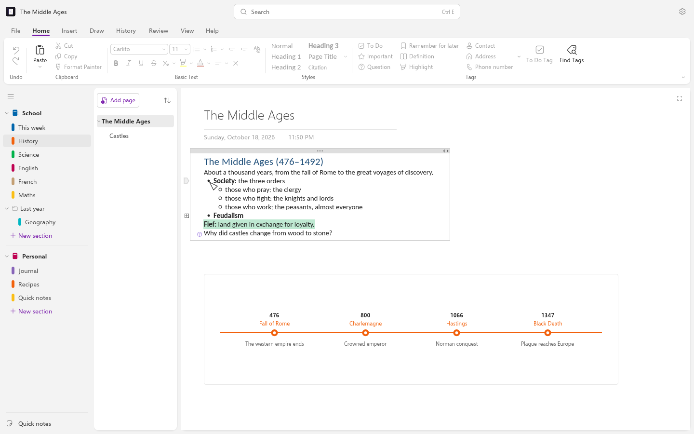
  <br><sub>A note container on hover: its grab bar, the paragraph handle and a folded paragraph.</sub>
</p>

<p align="center">
  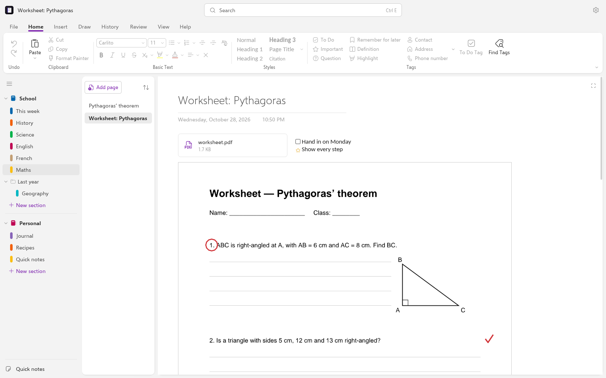
  <br><sub>A file printout: each page of a PDF becomes a picture you can write and draw on.</sub>
</p>

<p align="center">
  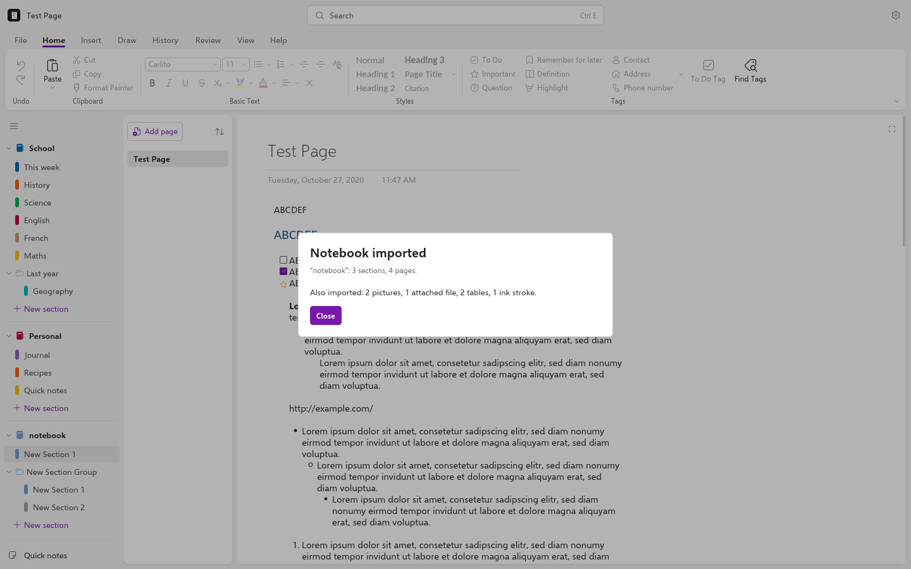
  <br><sub>The report after importing a notebook.</sub>
</p>

<p align="center">
  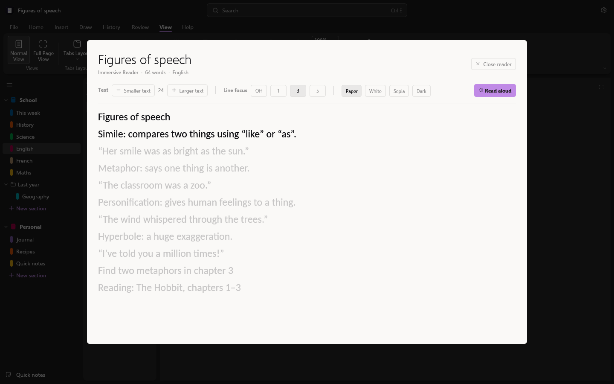
  <br><sub>Immersive Reader: text size, line focus, reading themes and read aloud.</sub>
</p>

<p align="center">
  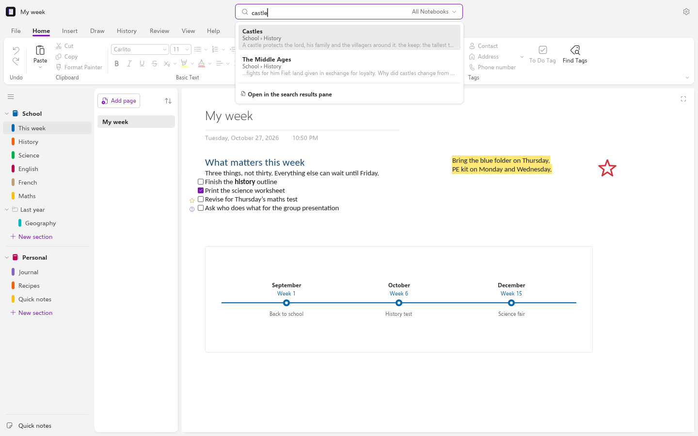
  <br><sub>Search lists its results under the box as you type.</sub>
</p>

## Importing notebooks

**File › Open › Import notebook…** copies a notebook into a new Folio notebook. Choose a file or a folder:

- a notebook package (`.onepkg`); Folio unpacks it itself, and refuses one that would unpack to more than 4 GB;
- a notebook folder, with its `.onetoc2`, its sections and its section-group folders, on this computer or in a synced folder (a picked `.onetoc2` stands for its folder);
- one section (`.one`).

Folio reads desktop-format notebook files with an open-source parser, so no other app is needed, and the source files are only read. The reading runs in the background with a "Page n of N" progress bar and a Cancel button. Nothing is added if it is cancelled or fails. The new notebook then opens, scrolled into view in the navigation pane.

What comes over:

- section groups, sections in their order with their colours (each becomes the nearest of Folio's 16), the notebook's colour, and pages and subpages with their dates and titles;
- note containers at their place and width, with outline levels, bullets and numbers, alignment, Heading 1–6 and the other built-in styles, bold, italic, underline, strikethrough, subscript and superscript, colour, highlight, size and font (the nearest bundled face);
- links to web pages, e-mail addresses and the imported pages;
- the 29 built-in tags, ticked or not, found by their icon or by their English or French name, and unknown tags as custom tags;
- equations in linear form, which become Folio equations, and tables, as their cells' text;
- PNG, JPEG and WebP pictures at their original size, with their alt text and background setting, and PDF printout pages as plain pictures;
- attached files, audio and video as file cards, and ink on the page.

The **report** ("Notebook imported") gives the sections and pages, what else came in (pictures, attached files, tables, ink strokes), and a **Not imported** list: password-protected and unreadable sections, files over 200 MB or whose contents the source app did not keep, tags with no name, pictures it cannot draw (kept as files), printout pages of word-processor documents, handwriting inside paragraphs, built-up equations such as stacked fractions (kept as text) and links to anything outside the import (the text stays). Page colour, rule lines, page versions and the Recycle Bin are not imported.

**Password-protected sections cannot be read.** A protected section on its own is refused with advice: remove the password in the app that made the notebook and export again. Inside a notebook, it is listed under Not imported.

The importer uses version 2.0 of its parser library. Version 2.1 (usable from 2 November 2026) will add pictures of document printout pages and Windows drive-letter paths: until then, a notebook opened from a drive-letter path on Windows lists its sections by name rather than in the source order.

## Languages

Folio's interface is in English and French. **File › Options › Language › Display language** offers *Automatic* (the default: French when the system language is French, English otherwise), *English* and *Français*. The change applies at once, without a restart, and is kept. Set `FOLIO_LANG=en` or `FOLIO_LANG=fr` to choose the language for one run (handy for screenshots and tests).

Everything Folio says follows the setting: the ribbon, menus, dialogs, panes, Backstage and Options, the canvas, the Immersive Reader, error messages and exported pages, which carry a matching `lang` attribute. The ribbon measures its labels in the current language and folds groups where they don't fit. French uses the standard French terms (*Fichier*, *Accueil*, *Insertion*, *Dessiner*, *Historique*, *Révision*, *Affichage*, *Bloc-notes*, *Notes rapides*, *Indicateurs*, *Impression de fichier*, *Corbeille du bloc-notes*). Dates, numbers and key names are written the French way: "jeudi 29 octobre 2026" with a 24-hour time, "1,5 Ko", and Ctrl, Maj, Alt, Entrée, Échap and Suppr in menus, tooltips and the shortcuts list. The Linux desktop entry has a French description.

The sample notebooks a first run creates are written in the language Folio starts in: *School* and *Personal* in English, *École* and *Personnel* in French, written for a French pupil rather than translated line by line. From then on they are your notes and are never retranslated. Names Folio gives (New notebook, New section) are created in the current language and then belong to you. Spell checking has its own language setting (Review › Proofing Language).

<p align="center">
  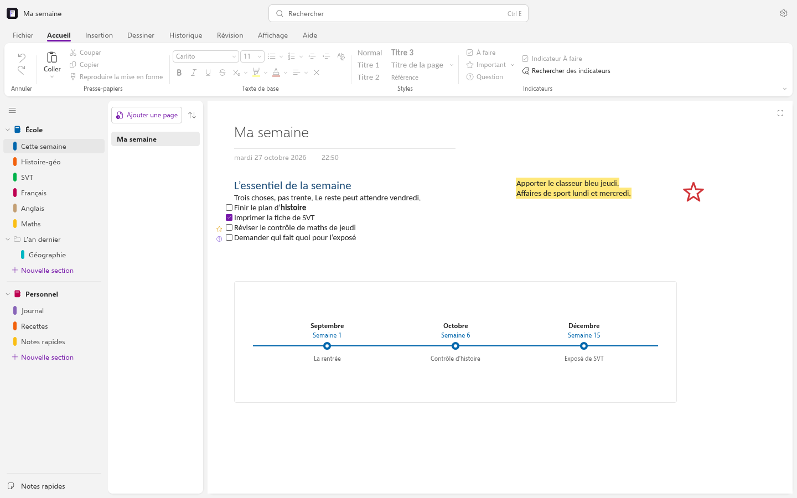
  <br><sub>The sample notebooks on a French system.</sub>
</p>

Translations are [Fluent](https://projectfluent.org/) files in `assets/locales/<code>/`, seven per language. To add a language:

1. Copy `assets/locales/en` to a folder named after the language's code and translate every message.
2. In `src/i18n.rs`, add a variant to `Lang` (its code in `code` and `from_code`, its own name in `endonym`, its place in `Lang::ALL` and in `lang()`), and add its seven files to `SOURCES`, growing the arrays sized by the number of languages.
3. Write its sample library beside `src/seed/fr.rs`, and follow the compiler to every other `match` on `Lang` (dates and times in `src/util.rs`, for example).
4. Run `cargo test --bin folio i18n`. The tests check that every language loads, that every language has every message with the same variables, that every message the code names exists and is used, French typography, and that every character has a glyph in Folio's fonts.

The Options language list and the tests that loop over languages pick the new language up from `Lang::ALL`.

## Build and run

Folio needs Rust 1.95 or newer.

```sh
cargo run --release
```

The first launch creates two sample notebooks, School and Personal, so the app has something to show. Delete or rename them freely. `folio --help` lists the command-line options: `--screenshot PATH` saves a picture of the window and exits, and `--size WxH` sets the window size.

### Linux packages

On Debian/Ubuntu, the build needs the usual X11/Wayland and graphics development packages:

```sh
sudo apt install build-essential pkg-config libxkbcommon-dev libwayland-dev \
  libx11-dev libxcursor-dev libxrandr-dev libxi-dev libegl1-mesa-dev \
  libgl1-mesa-dev libvulkan-dev libssl-dev libasound2-dev
```

libasound2-dev is for recording and playing audio notes. The PDF renderer (hayro), the notebook importer and SQLite (bundled by rusqlite) are compiled in and need no system packages.

`cargo run --release` produces a single native binary at `target/release/folio`, with its fonts, icons, dictionaries and translations built in.

To install it for the current user:

```sh
install -Dm755 target/release/folio ~/.local/bin/folio
install -Dm644 packaging/folio.desktop ~/.local/share/applications/folio.desktop
install -Dm644 assets/icon.png ~/.local/share/icons/hicolor/256x256/apps/folio.png
```

### Windows

```powershell
cargo build --release
.\target\release\folio.exe
```

The executable icon is embedded through `build.rs`; no runtime assets are needed.

### macOS

```sh
cargo build --release
```

To build an unsigned `.app` bundle, install [`cargo-bundle`](https://github.com/burtonageo/cargo-bundle), then:

```sh
cargo bundle --release
open target/release/bundle/osx/Folio.app
```

The app icon (`assets/icon.icns`) is declared in the bundle metadata in `Cargo.toml`.

### Tests

CI runs these on Linux, Windows and macOS:

```sh
cargo fmt --all -- --check
cargo clippy --all-targets -- -D warnings
cargo test --all-targets
```

Folio is a binary crate, so a filtered run is `cargo test --bin folio <filter>`.

The UI tests in `src/ui_tests.rs` drive the real app with `egui_kittest`, by pointer and keyboard: typing anywhere and formatting from the ribbon and the keys; note containers (the grab bar, widening as you type, merging with Shift+drag, empty notes going away); outlines (Tab and the Alt+Shift keys, paragraph handles that select, fold and move, levels and styles); selection (Shift+click, a drag on empty paper, the lasso, Ctrl+A, nudges); tables (Tab, Enter, Alt+Enter, the Table tab, column borders, copying cells); pictures (rotating, flipping, alt text, backgrounds, resizing); paste options, pasting from other apps and the Format Painter; pens, erasers, Ink to Shape, shapes, Lock Drawing Mode, Arrange and Rotate; links, tags and Find Tags (on AZERTY too), find on page, search scopes and spelling; pages, subpages, sorting, section groups, Move or Copy and merging sections; page versions, Recent Edits and the Recycle Bin; file cards, PDF printouts (dropped, inserted, locked by a password, restored to size, copied as text), audio recordings, equations, symbols, page templates, time stamps and Insert Space; the ribbon at every window width, the Simplified ribbon, tabs only and the contextual tabs; the navigation pane, Horizontal Tabs, Full Page View, the page's title and date pickers, rule lines, page colour, Switch Background and scrolling; Backstage, Options and Help; notebook import; and the French interface, which must fit and switch live. Tests start the app in English (`Ui::start`, or `Ui::start_in(Lang::Fr)` for French) on a fresh sample library in a temporary folder.

Set `FOLIO_SHOTS=/some/folder` to save a screenshot at each step of a UI test.

The galleries take screenshots for review and documentation:

```sh
FOLIO_SHOTS=/tmp/folio-gallery cargo test --bin folio gallery -- --ignored
```

`gallery` pictures every sample page, the page hovered and being typed in, menus, dialogs and tooltips, containers and outlines, the page options, the shell, the ribbon's tabs and blocks, tables, pictures, Backstage, Options, search, Horizontal Tabs, a printout and the import report, in light and dark. `gallery_fr` pictures the French surfaces, with a dark pass.

`readme_shots` takes the pictures in this README, at 1440 × 900. Save them in `docs/images` as RGB (Python with Pillow), so translucent 1 px seams turn dark as they look in the app:

```sh
FOLIO_SHOTS=/tmp/folio-readme cargo test --bin folio readme_shots -- --ignored
python3 - /tmp/folio-readme docs/images <<'PY'
import sys, pathlib
from PIL import Image
src, dst = pathlib.Path(sys.argv[1]), pathlib.Path(sys.argv[2])
for png in sorted(src.glob("folio-*.png")):
    Image.open(png).convert("RGB").save(dst / png.name, optimize=True)
    print(png.name, Image.open(dst / png.name).size)
PY
```

`cargo test --bin folio i18n` runs the language tests (see [Languages](#languages)). `cargo test --bin folio sample_` runs the sample library's tests: a golden hash of the English library (it changes only on purpose: read the dump the failure prints, check it, and paste the new hash), the French library having the same shape and following French typography, the sample files on disk, and every sample page opening in both languages.

## Keyboard

Help › Keyboard shortcuts lists these keys, in the interface language. They are written for Windows and Linux; on macOS, ⌘ takes Ctrl's place, ⌥ Alt's and ⇧ Shift's.

| Action | Keys |
| --- | --- |
| Search everything | `Ctrl+E` |
| New page | `Ctrl+N` |
| New section | `Ctrl+T` |
| New notebook | `Ctrl+Shift+N` |
| New Quick Note | `Ctrl+Shift+M` |
| Save now | `Ctrl+S` |
| Print the page | `Ctrl+P` |
| Open the File tab | `Alt+F` |
| Check spelling | `F7` |
| Go to the page title | `Ctrl+Shift+T` |
| Show or hide rule lines | `Ctrl+Shift+R` |
| Full Page View | `F11` |
| Show or hide the ribbon | `Ctrl+F1` |
| Find on page | `Ctrl+F` |
| Options | `Ctrl+,` |
| Bold / italic / underline | `Ctrl+B` · `Ctrl+I` · `Ctrl+U` |
| Insert link (while typing) | `Ctrl+K` |
| Open a link | `Ctrl+Click` |
| Bigger / smaller text | `Ctrl+Shift+>` · `Ctrl+Shift+<` |
| Superscript / subscript | `Ctrl+Shift+=` · `Ctrl+=` |
| Align left / right | `Ctrl+L` · `Ctrl+R` |
| Clear formatting | `Ctrl+Shift+N` |
| New block | `Enter` |
| Indent / outdent | `Tab` / `Shift+Tab` · `Alt+Shift+→` / `Alt+Shift+←` |
| Undo / redo | `Ctrl+Z` · `Ctrl+Shift+Z` |
| Headings 1 to 6 | `Ctrl+Alt+1` … `Ctrl+Alt+6` |
| Move paragraph up / down | `Alt+Shift+↑` · `Alt+Shift+↓` |
| Show outline levels | `Alt+Shift+0` … `Alt+Shift+9` |
| Expand / collapse the paragraph | `Alt+Shift++` · `Alt+Shift+-` |
| Select everything on the page | `Ctrl+A` |
| Move around the page | `Space` + drag |
| Insert equation | `Alt+=` |
| Insert date / time / both | `Alt+Shift+D` · `Alt+Shift+T` · `Alt+Shift+F` |
| New page below / subpage | `Ctrl+Alt+N` · `Ctrl+Alt+Shift+N` |
| Make subpage / promote | `Ctrl+Alt+]` · `Ctrl+Alt+[` |
| Move or copy the page | `Ctrl+Alt+M` |
| To Do / tags | `Ctrl+1` … `Ctrl+9` |
| Remove tags | `Ctrl+0` |

`Ctrl+Shift+N` clears formatting while you type in a note, and makes a new notebook anywhere else. `Ctrl+A` selects everything on the page when no note has the caret. `Ctrl+Y` redoes too. Folio also takes a few keys of its own: `Ctrl+K` searches when no note has the caret, the arrow keys nudge selected items (with `Shift`, by 10 px), `Enter` on a selected item edits or opens it, and `Esc` steps out, from typing to the selected note and then to nothing. Help › Keyboard shortcuts lists every shortcut.

## Where your notes live

Folio stores everything in a single SQLite database, `folio.db`, plus an `attachments/` folder for pictures, files, recordings and printout pages:

| Platform | Default location |
| --- | --- |
| Linux | `$XDG_DATA_HOME/folio` or `~/.local/share/folio` |
| macOS | `~/Library/Application Support/Folio` |
| Windows | `%APPDATA%\Folio` |

Set `FOLIO_DATA_DIR=/some/folder` to use another location.

**File › Options › Save & Backup** (also shown on **File › Info**) gives the exact path and two buttons. **Back up** asks for a file name and writes a compacted copy of the database there, plus a `<name>-attachments` folder with the pictures and files; it refuses a place inside the data folder. **Open folder** opens the data folder. Page versions and the Recycle Bin live in the same database, so backups include them. Restoring a backup is done by hand, with Folio closed: the backup's `.db` file becomes `folio.db`, and its `-attachments` folder becomes `attachments/`. File › Export saves a page, a section or a notebook as web pages if you want a portable copy. File › Options (also `Ctrl+,`, or the gear at the window's top right) holds every setting: General, Display, Proofing, Save & Backup, Language and Advanced.

The data folder also holds `open/`, copies of attached files opened in other apps (changes made there are not saved back into the page), and `print/`, the print-ready copies of pages sent to the browser. If a page ever contains data this version can't read (for example, written by a newer Folio), the readable parts open normally and the original is kept in a `recovered/` folder, so an autosave can't overwrite it.

## Architecture

| Layer | Where | Job |
| --- | --- | --- |
| App shell | `src/app.rs` | Window layout, navigation pane and page list, Backstage, Options, dialogs, panes, search, autosave, commands |
| Ribbon | `src/ribbon.rs` | The Classic and Simplified ribbons: tabs, groups, controls and menus, scaled to the window in the current language |
| Canvas | `src/canvas.rs`, `src/find.rs` | The page: title and date, note containers, ink, shapes, pictures, file cards, recordings, frises, printouts, selection; find on page |
| Editor | `src/editor.rs`, `src/table.rs`, `src/paste.rs`, `src/clipboard.rs` | Text in note containers: outlines, styles, lists, tags, table blocks, undo, keyboard editing; paste options and rich paste from other apps |
| Document | `src/model.rs` | Pages, canvas items, blocks, inline styles, page style, serialisation |
| Data | `src/db.rs`, `src/outline.rs`, `src/seed.rs`, `src/seed/fr.rs`, `src/templates.rs` | SQLite schema and queries, page versions, Recycle Bin, backup; page order and subpages; the sample library in English and French; page templates |
| Printouts | `src/pdf.rs` | PDF pages drawn to pictures with hayro, their text, passwords |
| Notebook import | `src/import_notebook.rs` | Reads `.onepkg` packages, notebook folders and `.one` sections on a worker thread into a plan that `db.rs` writes in one transaction |
| Pictures | `src/images.rs` | Decoding pictures upright, texture sizes and the texture cache |
| Ink | `src/ink_shapes.rs` | Ink to Shape recognition |
| Equations | `src/math.rs` | Equation parser (linear form and LaTeX), layout, MathML and LaTeX output |
| Spelling | `src/spell.rs`, `assets/dictionaries/` | Hunspell dictionaries, squiggles, suggestions, personal dictionary |
| Audio | `src/audio.rs` | Microphone recording to WAV and playback through `cpal` |
| Reader | `src/reading.rs`, `src/speech.rs` | Immersive Reader, line focus, system read-aloud |
| Print/export | `src/export.rs` | Print-ready HTML and web page export with embedded pictures and files |
| Interface | `src/theme.rs`, `src/widgets.rs`, `src/icons.rs`, `assets/fonts/` | The desktop design: design tokens, Selawik and Carlito fonts, Fluent UI System Icons, shared controls |
| Languages | `src/i18n.rs`, `src/util.rs`, `assets/locales/` | Interface language, Fluent message files (en, fr), dates, numbers and key names |
| Platform | `src/main.rs`, `build.rs`, `packaging/` | Native window, icons, platform data paths, Linux desktop entry |
| Website | `site/` | Static landing page and licences, deployed by GitHub Pages |
| Tests | `src/ui_tests.rs`, `tests/fixtures/` | UI tests; sample notebook files (MIT and MPL-2.0, see [`tests/fixtures/notebooks/README.md`](tests/fixtures/notebooks/README.md)) and a locked PDF |

Text in a note is native egui text with styled runs, not a web rich-text engine, so there is no browser engine in the loop.

## What is not here yet

Folio is an alpha, and some features are out of its reach or not built yet:

- No cloud account, sync, sharing or co-authoring: notes stay on this computer.
- No AI assistant or online services: no web lookup, translation, online pictures or video, stickers or live components.
- No external integrations: no task sync, e-mailed pages, meeting details, embedded spreadsheets or diagrams, or linked notes.
- No handwriting, maths or text recognition (OCR), and no dictation or transcription.
- Printouts are for PDFs only; other documents are attached as files. Folio exports web pages, not `.one`, `.onepkg` or office-document files (PDF goes through the browser's print).
- One window and one library: no New Window, docked window or separate Quick Note window, no Open Notebook, and no section passwords.
- Built-in tags cannot be changed or deleted; no Merge Cells, Ruler, ink replay, crop or 45° turns; English and French only, with no right-to-left text.
- No signed installers: the GitHub workflows produce unsigned builds.

## Design

The visual system is documented in [DESIGN.md](DESIGN.md), and the product intent in [PRODUCT.md](PRODUCT.md). The short version: a light window, white cards, the full ribbon and Calibri-like notes.

## License

MIT OR Apache-2.0. Fonts and icons keep their own open licenses; see [THIRD_PARTY.md](THIRD_PARTY.md).
